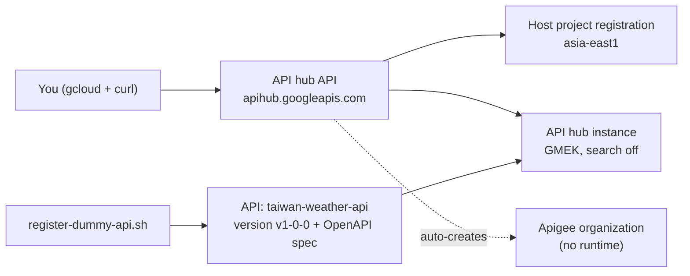

# Set up Apigee API hub (standalone, no gateway runtime)

Scripts to provision **Apigee API hub on its own**, without an Apigee API gateway
runtime, in a single Google Cloud project. A second script registers a dummy API so
you can see API hub working end to end.

The defaults target **Taiwan (`asia-east1`)** and keep all API hub data in that region.

> [!NOTE]
> This is a demo sample, not an official Google product. Review the scripts before
> running them in your own environment.

## What gets created

| Resource | Details |
|---|---|
| API hub API | `apihub.googleapis.com` turned on. This also turns on `apigee.googleapis.com` automatically. |
| API hub service agent | `service-YOUR_PROJECT_NUMBER@gcp-sa-apihub.iam.gserviceaccount.com`, granted `roles/apihub.admin` and `roles/apihub.runtimeProjectServiceAgent` |
| Host project registration | Your project, registered as the API hub host project in the chosen region |
| API hub instance | `apihub-taiwan`, with Google-managed encryption keys (GMEK) and Semantic Search turned off |
| Apigee organization | Created automatically by API hub if none exists. It's the management layer only. |

**Not created:** Apigee runtime instances, environments, environment groups, or
networking (VPC peering / PSC). There is no API gateway.



## Design choices

- **Region `asia-east1` (Taiwan).** API hub supports this region, and Cloud Scheduler
  is available there too, so no fallback region is needed. See
  [API hub locations](https://cloud.google.com/apigee/docs/apihub/locations).
- **Semantic Search off (`disableSearch: true`).** Semantic Search (Vertex AI) can only
  store its data in the `us` or `eu` multi-region. Turning it off keeps all data in Taiwan.
- **GMEK encryption.** No Cloud KMS key to manage. See the
  [CLI provisioning guide](https://cloud.google.com/apigee/docs/apihub/provision-cli)
  if you need CMEK instead.

## Prerequisites

- A Google Cloud project with billing enabled.
- No `gcp.resourceLocations` org policy that blocks the chosen region.
- If API hub was deprovisioned in this project recently, wait 7 days before provisioning it again.
- `gcloud` installed and logged in (`gcloud auth login`), plus `curl` and `python3`.
- These roles on the project:
  - `roles/apihub.provisioningAdmin`
  - `roles/serviceusage.serviceUsageAdmin`
  - `roles/resourcemanager.projectIamAdmin`
  - `roles/cloudkms.admin`, only if you use CMEK

## Usage

### 1. Provision API hub

```bash
export PROJECT_ID=YOUR_PROJECT_ID     # required
export REGION=asia-east1              # optional (default: asia-east1)
export INSTANCE_ID=apihub-taiwan      # optional (default: apihub-taiwan)

./setup-apihub.sh
```

The script is safe to re-run: it skips the host registration and instance if they
already exist. The first time can take **20 to 30 minutes**, because API hub also
creates the Apigee organization. The script waits up to about 60 minutes.

When it finishes, the instance shows `"state": "ACTIVE"`:

```json
{
  "name": "projects/YOUR_PROJECT_ID/locations/asia-east1/apiHubInstances/apihub-taiwan",
  "state": "ACTIVE",
  "config": { "disableSearch": true, "encryptionType": "GMEK" }
}
```

### 2. Register a dummy API

```bash
./register-dummy-api.sh
```

This creates:

- the API `taiwan-weather-api` (REST style, with an owner and a docs link)
- version `v1-0-0`
- the spec `openapi-v1`, uploaded from
  [`samples/taiwan-weather-openapi.yaml`](samples/taiwan-weather-openapi.yaml)

API hub reads the spec and finds three operations: `GET /cities`,
`GET /cities/{cityId}/current`, and `GET /cities/{cityId}/forecast`.

### 3. View it in the console

`https://console.cloud.google.com/apigee/api-hub/apis?project=YOUR_PROJECT_ID`

## Repository layout

```
.
├── setup-apihub.sh                    # Provision standalone API hub
├── register-dummy-api.sh              # Register a dummy API + version + spec
└── samples/
    └── taiwan-weather-openapi.yaml    # Dummy OpenAPI 3.0 spec
```

## Clean up

To delete the dummy API:

```bash
curl -X DELETE -H "Authorization: Bearer $(gcloud auth print-access-token)" \
  "https://apihub.googleapis.com/v1/projects/YOUR_PROJECT_ID/locations/asia-east1/apis/taiwan-weather-api?force=true"
```

To remove API hub completely, deprovision it from the console. This also moves the
auto-created Apigee organization into a 7-day soft-delete period.

## References

- [Provision API hub (console)](https://cloud.google.com/apigee/docs/apihub/provision)
- [Provision API hub from the command line](https://cloud.google.com/apigee/docs/apihub/provision-cli)
- [API hub locations](https://cloud.google.com/apigee/docs/apihub/locations)
- [API hub REST reference](https://cloud.google.com/apigee/docs/reference/apis/apihub/rest)
